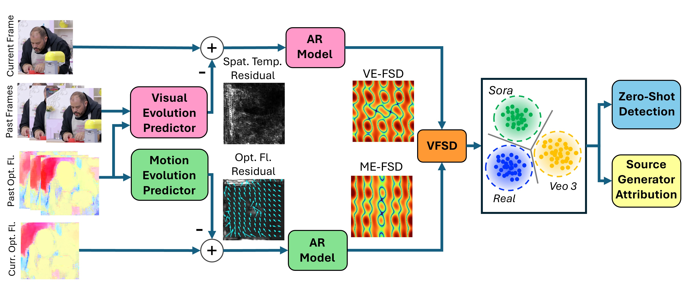

# Video Forensic Self-Descriptions (VFSD)

Official PyTorch implementation of the paper:  
**"Video Forensic Self-Descriptions: Leveraging Temporally Distributed Forensic Microstructures for Zero-Shot Detection of AI-Generated Videos"**  
*Accepted as an Oral Presentation at NeurIPS 2026.*

[](https://arefazizpour.github.io/VFSD-NeurIPS2026/)
[](https://neurips.cc/)
[](https://opensource.org/licenses/MIT)

**Authors:** [Aref Azizpour](https://arefazizpour.github.io/)<sup>1</sup>, Tai D. Nguyen<sup>1</sup>, Matthew C. Stamm<sup>1</sup>  
<sup>1</sup>Department of Electrical and Computer Engineering, Drexel University

---

## 📌 Overview


*Figure 1: Overview of the Video Forensic Self-Description (VFSD) framework.*

AI-generated videos are becoming increasingly realistic, yet most detection methods focus on spatial artifacts within individual frames and require synthetic training data from known generators, causing them to fail on unseen generators. We identify two previously unexplored *temporally distributed forensic microstructures* that reveal whether a video was AI-generated. These traces arise from how a video's visual field and motion evolve over time, capturing subtle deviations that generators introduce when approximating real-world temporal dynamics.

To expose them, we train two simple predictors on real videos only, modeling visual evolution (**VE-FSD**) and motion evolution (**ME-FSD**), and analyze their prediction residuals. We then fit 3D spatio-temporal autoregressive models to these residuals, producing compact descriptors called **Video Forensic Self-Descriptions (VFSD)**. VFSDs of real videos naturally cluster together and separate from AI-generated ones, enabling zero-shot detection without synthetic training data and source attribution across 35 generative models.

---

## 🚀 Getting Started

*(Code and pre-trained weights release coming soon)*

### Environment Setup
```bash
git clone https://github.com/arefazizpour/VFSD-NeurIPS2026.git
cd VFSD-NeurIPS2026
```

---

## 📖 Citation

If you find this work or codebase useful in your research, please cite:

```bibtex
@inproceedings{azizpour2026video,
  title={Video Forensic Self-Descriptions: Leveraging Temporally Distributed Forensic Microstructures for Zero-Shot Detection of AI-Generated Videos},
  author={Azizpour, Aref and Nguyen, Tai D. and Stamm, Matthew C.},
  booktitle={Advances in Neural Information Processing Systems (NeurIPS)},
  year={2026}
}
```

---

## ✉️ Contact
For questions or issues, please open an issue or contact `aa4639@drexel.edu` ([Website](https://arefazizpour.github.io/)).
